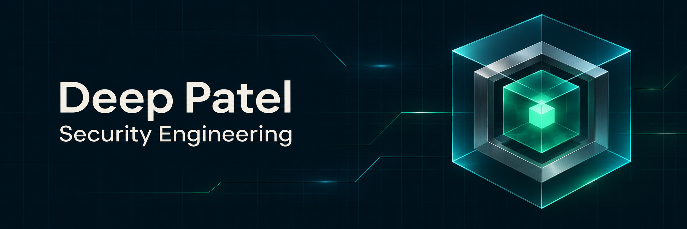
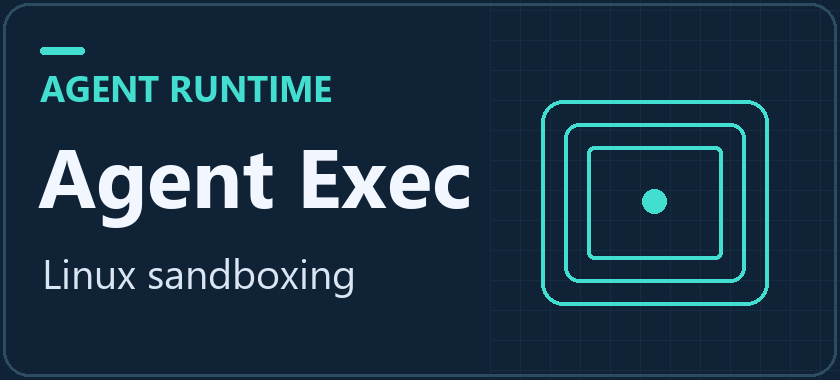
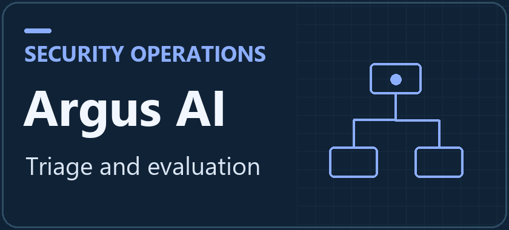
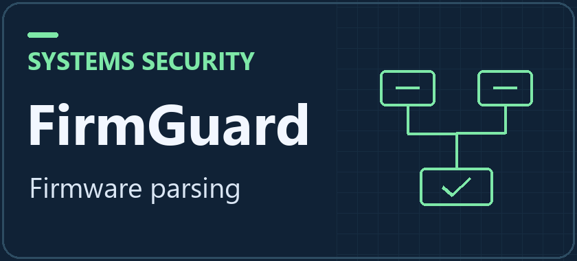



  

  <strong>AI agent security · Application security · Security automation</strong> 
  San Francisco Bay Area · <a href="https://www.linkedin.com/in/deep-patel-security">Connect on LinkedIn</a>

I build security tools and backends in Go and Python. My projects cover how to contain untrusted code, evaluate AI-assisted security workflows, and verify what happens when systems fail. I use TypeScript and React for operator-facing interfaces.

## Featured projects

<table>
  <tr>
    <td width="33%" align="center">
      
    </td>
    <td width="33%" align="center">
      
    </td>
    <td width="33%" align="center">
      
    </td>
  </tr>
</table>

### Agent Exec

I built a Go service for running AI-generated Python and shell jobs inside Linux sandboxes. In a local forced-restart test, the same job ID returned `interrupted` after recovery. A separate regression test recorded **zero calls to run the old job again**.

<strong>Explore the sandbox and recovery tests</strong>

The service scopes job access to the authenticated caller, starts each workload inside a resource-limited cgroup, and records job transitions in an audit log. Recovery leaves the retry decision with the caller. The documented deployment target is one dedicated Linux host or VM with a loopback API and a shared kernel.

[Architecture](https://github.com/Deep-Patel2002/agent-exec/blob/main/docs/ARCHITECTURE.md) · [Verification results](https://github.com/Deep-Patel2002/agent-exec/blob/main/docs/VERIFICATION.md)

### Argus AI

I built a FastAPI service for a simulated security operations center. The copilot cites alert and playbook records. The triage agent proposes actions in **dry-run mode by default**, with human approval required for high-risk playbooks.

<strong>Explore the triage and retrieval evaluations</strong>

The evaluation harness checks escalation recall, retrieval quality, and whether the copilot abstains when the available records cannot support an answer. It reports missed escalations and returns a failing exit code when a metric falls below its configured threshold.

[Project overview and offline quick start](https://github.com/Deep-Patel2002/Argus-AI) · [Evaluation harness](https://github.com/Deep-Patel2002/Argus-AI/blob/main/app/evals/run_evals.py)

### FirmGuard

I implemented a C11 parser and a safe Rust parser for a project-defined firmware manifest format. Both agreed on all **316 deterministic test inputs**. A separate local fuzz run with sanitizers processed **3.5 million inputs without a crash**.

<strong>Explore the parser design and fuzz results</strong>

The parsers bound input size and check manifest structure and fields before callers use the metadata. The verification report includes the differential corpus, fuzz run, and benchmark conditions.

[Repository and architecture](https://github.com/Deep-Patel2002/firmguard) · [Verification results](https://github.com/Deep-Patel2002/firmguard/blob/main/docs/VERIFICATION.md)

## Research and other work

<strong>Open the research paper and earlier projects</strong>

- [Adaptive and explainable AI for cloud incident detection · research paper](https://github.com/Deep-Patel2002/Adaptive-and-Explainable-AI-for-Cyber-Incident-Detection-and-Response-in-Cloud-Environments)
- [MERN e-commerce application](https://github.com/Deep-Patel2002/Ecommerce-app_MERN-Stack-Project)
- [Shipment price prediction](https://github.com/Deep-Patel2002/Shipment-Price-Prediction_Machine-Learning)

I’m open to security engineering roles and conversations about how teams test AI systems and design secure execution environments. [Connect on LinkedIn](https://www.linkedin.com/in/deep-patel-security)

